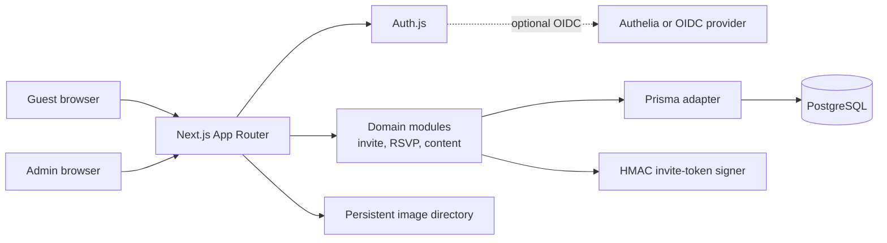
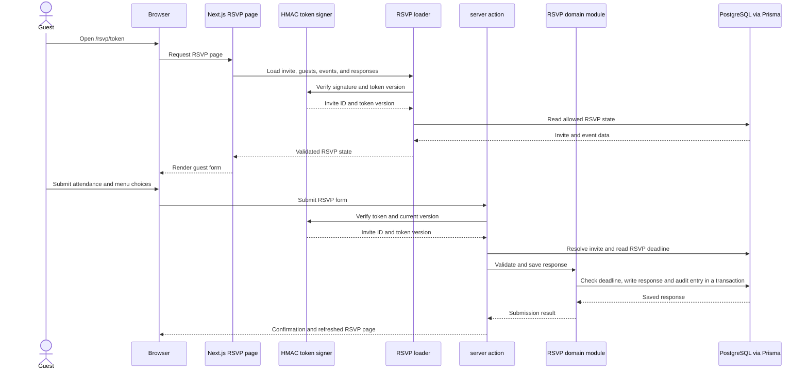
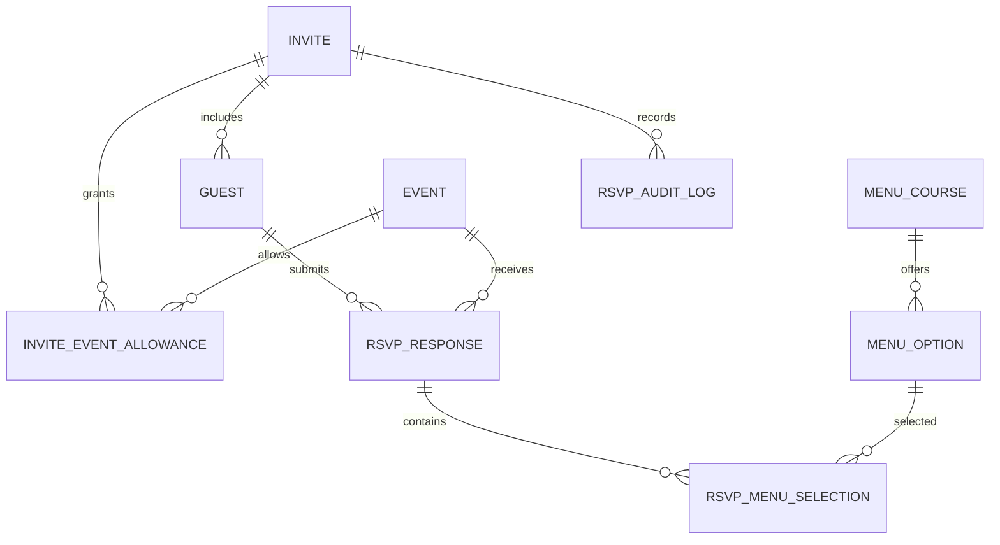

# Architecture

> System design, components, and data flow for Wedding.

## Overview

Wedding is a self-hosted bilingual site built as one Next.js application. Guest pages
and the admin panel use the same app, which runs domain logic on the server and persists
structured data in PostgreSQL through Prisma. Guest access uses signed household invite
links; administrators use Auth.js with OIDC or password sign-in.

## Diagram

## Components

| Component | Responsibility | Location |
|-----------|---------------|----------|
| Guest pages | Localised public pages, event details, and token-based RSVP forms | `src/app/(public)/`, `src/app/rsvp/[token]/` |
| Admin panel | Authenticated editing for invites, guests, events, menus, content, and settings | `src/app/admin/` |
| Route handlers and server actions | Handle RSVP submissions, image uploads, exports, health checks, and admin mutations | `src/app/api/`, `src/app/rsvp/[token]/actions.ts`, `src/app/admin/` |
| Domain modules | Validate invite, RSVP, menu, content, and export operations; return result-style errors | `src/lib/invite/`, `src/lib/rsvp/`, `src/lib/content/`, `src/lib/csv/` |
| Authentication | Auth.js configuration, admin identity, Edge-safe middleware, and Node-only Prisma-backed setup | `src/server/auth.config.ts`, `src/server/auth.ts`, `src/middleware.ts` |
| Database | PostgreSQL schema, migrations, and Prisma client | `prisma/`, `src/server/db.ts` |
| Image storage | Uploaded image files plus database metadata | `UPLOAD_DIR` (defaults to `public/uploads`), `ImageAsset` model |

## Request Flow

A guest opens a signed RSVP link and submits a response. The page and server action run
in the Node.js runtime because they access Prisma.

## Key Decisions

- **Keep the application in one release unit.** Next.js serves the site and runs its
  server actions and route handlers. Domain rules live in `src/lib/`; Prisma access
  stays on the server.
- **Separate Edge-safe authentication from Node-only database work.**
  `src/middleware.ts` imports the lean auth config. Prisma-backed authentication and
  routes run in Node.js.
- **Make guest links revocable.** Each signed token includes an invite ID and token
  version. Rotating the version invalidates older links without deleting guest data.
- **Record RSVP changes.** Response writes and their append-only audit entries are
  committed together in a PostgreSQL transaction.
- **Persist uploaded files separately from their metadata.** PostgreSQL stores image
  metadata. The image bytes live in `UPLOAD_DIR`, which must persist with the self-
  hosted deployment.

## Data Model

A response is unique for each guest and event. An invite's event allowances control
which events its guests can attend. Menu courses can be shared across events or tied to
one event. The full schema is in `prisma/schema.prisma`.

## External Dependencies

| Service | Purpose | Failure mode |
|---------|---------|--------------|
| PostgreSQL | Stores invites, guests, events, RSVPs, content, settings, and audit records | Guest and admin operations that need data cannot complete until the database is available. |
| OIDC provider | Optional administrator sign-in through Auth.js | Use the configured password login when enabled; otherwise admin sign-in is unavailable until OIDC recovers. |
| Persistent filesystem | Stores uploaded image bytes referenced by `ImageAsset` rows | Images are unavailable if the upload directory is missing; restore it with the database backup. |
